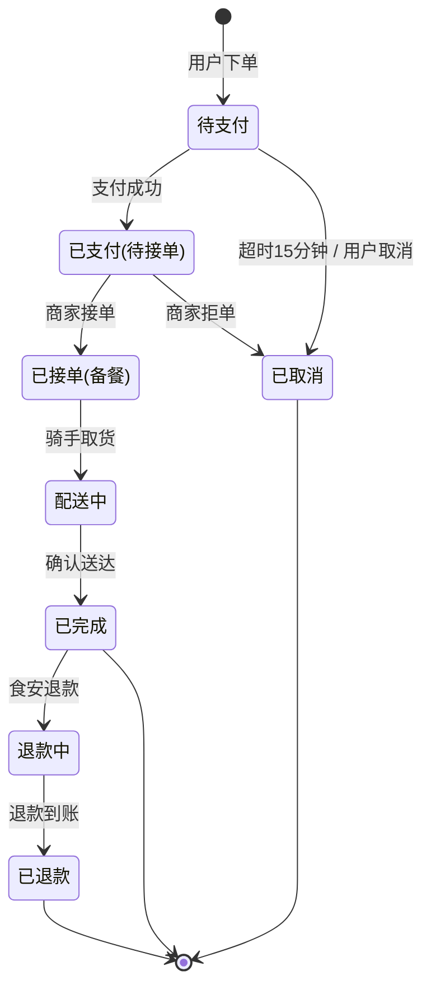

### **外卖订单**

**状态图：**



**迁移表：**

| 当前状态 | 事件         | 目标状态 | 类型             | 用例 |
| -------- | ------------ | -------- | ---------------- | ---- |
| —        | 用户下单     | 待支付   | 合法             | O01  |
| 待支付   | 支付成功     | 已支付   | 合法             | O02  |
| 待支付   | 超时 15 分钟 | 已取消   | 合法             | O04  |
| 待支付   | 用户取消     | 已取消   | 合法             | O03  |
| 已支付   | 商家接单     | 已接单   | 合法             | O06  |
| 已支付   | 商家拒单     | 已取消   | **B 类：要退款** | —    |
| 已接单   | 骑手取货     | 配送中   | 合法             | —    |
| 配送中   | 确认送达     | 已完成   | 合法             | O11  |
| 已完成   | 食安退款     | 退款中   | 合法-副作用      | O09  |
| 待支付   | 发货/接单    | —        | **A 类非法**     | O16  |
| 待支付   | 完成         | —        | **A 类非法**     | —    |
| 已取消   | 配送         | —        | **A 类非法**     | —    |
| 配送中   | 取消         | 已取消   | **B 类：要退款** | —    |
| 已接单   | 取消         | 已取消   | **B 类：要退款** | —    |

A 类：这条边根本不该存在

```
任何情况下都不允许，系统必须返回错误，状态不变。
例：待支付→已接单（没付钱就接单）、已取消→配送中（终态复活）。
```

B 类：边可以走，但副作用必须做对

```
状态变化是允许的，但钱/券/库存必须算对，错在这里就是资损。
例：已支付→已取消（拒单要退款）、配送中→已取消（要扣配送费或赔付）。
```

**非法迁移：**

1. 待支付->已接单 没给钱就先接单，资损
2. 待支付->已完成 平台凭空生成订单
3. 已取消->配送中 送出去了收不到钱

支付失败  用户支付失败，订单状态不变（还是待支付） 事件不迁移

**矩阵覆盖（这张是讲义里面的）**

**横着看是"这个状态下所有事件"（穷举），竖着看是"这个事件在所有状态下"（找非法）。**

| 状态 \ 事件 | 下单   | 支付成功   | 接单       | 取货       | 送达       | 取消   | 退款   |
| ----------- | ------ | ---------- | ---------- | ---------- | ---------- | ------ | ------ |
| 待支付      | 待支付 | **已支付** | ✗          | ✗          | ✗          | 已取消 | ✗      |
| 已支付      | ✗      | ✗          | **已接单** | ✗          | ✗          | 已取消 | 已取消 |
| 已接单      | ✗      | ✗          | ✗          | **配送中** | ✗          | 已取消 | 已取消 |
| 配送中      | ✗      | ✗          | ✗          | ✗          | **已完成** | 已取消 | 已取消 |
| 已完成      | ✗      | ✗          | ✗          | ✗          | ✗          | ✗      | 退款中 |
| 已取消      | ✗      | ✗          | ✗          | ✗          | ✗          | ✗      | ✗      |


「附录：电商订单状态机（参考）」

| 当前状态 | 事件                                 | 目标状态 | 合法？ |
| -------- | ------------------------------------ | -------- | ------ |
| 待付款   | 支付成功                             | 已付款   | ✓      |
| 待付款   | 取消                                 | 已关闭   | ✓      |
| 待付款   | 超时 30 分钟                         | 已关闭   | ✓      |
| 待付款   | 发货                                 | —        | ✗      |
| 待发货   | 商家发货                             | 已发货   | ✓      |
| 待发货   | 用户申请退款（未出库仅退款）         | 退款中   | ✓      |
| 待发货   | 商家拒绝退款                         | 待发货   | ✓      |
| 待发货   | 退款到账                             | 待确认   | ✓      |
| 已发货   | 用户确认收货                         | 已完成   | ✓      |
| 已发货   | 物流签收                             | 已签收   | ✓      |
| 已发货   | 用户取消                             | 待退货   | ✓      |
| 已发货   | 用户已签收加商家同意退款             | 退货中   | ✓      |
| 退货中   | 商家收到退货                         | 退款中   | ✓      |
| 退货中   | 用户撤销                             | 回已发货 | ✓      |
| 已关闭   | 支付成功回调                         | —        | ✗      |
| 已完成   | 退款（超时售后）                     | —        | ✗      |
| 退款中   | 发货（退款没走完又发货，库存对不上） | —        | ✗      |
| 已退款   | 再次退款（重复退款，资损）           | —        | ✗      |
|          |                                      |          |        |
