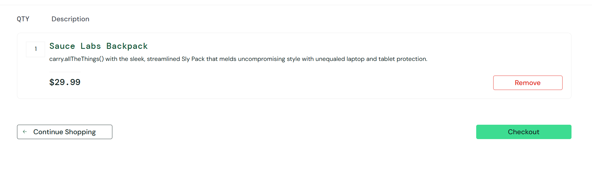
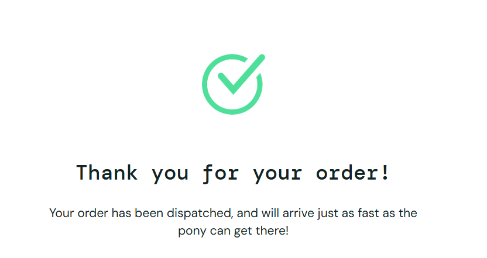
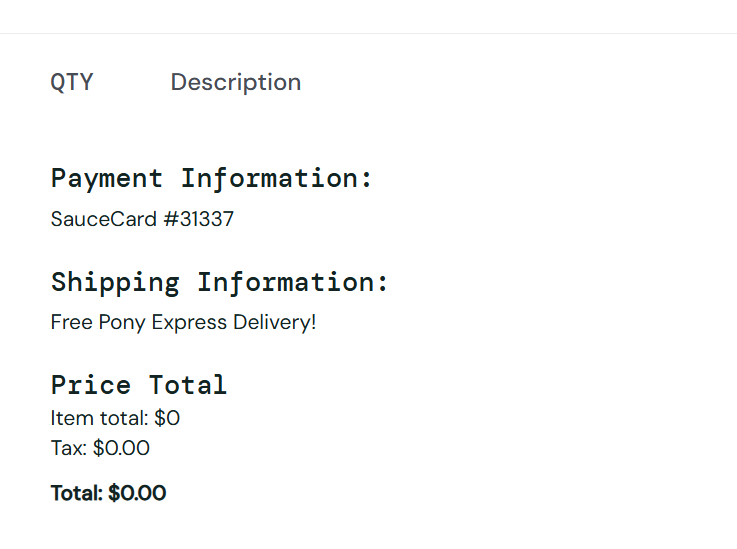
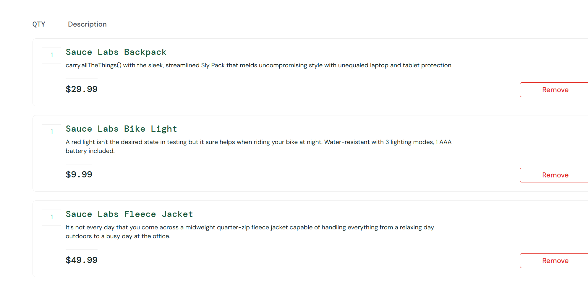

| 用例号 | 结果(通过/失败/阻塞) | 实际结果                 | 与预期的差异     | 截图                                                         |
| ------ | -------------------- | ------------------------ | ---------------- | ------------------------------------------------------------ |
| C01    | 失败                 | 无法在购物车界面增加商品 | 购物车姐界面不同 |  |
| C09    | 通过                 | 结算成功                 | —                |  |
| C10    | 失败                 | 可空结算                 | 没有出现拦截     |  |
| C13    | 阻塞                 | 没有可勾选的选择         | 无勾选功能       |  |
| C19    | 通过                 | 删除正常                 | —                | （无截图演示）                                               |

